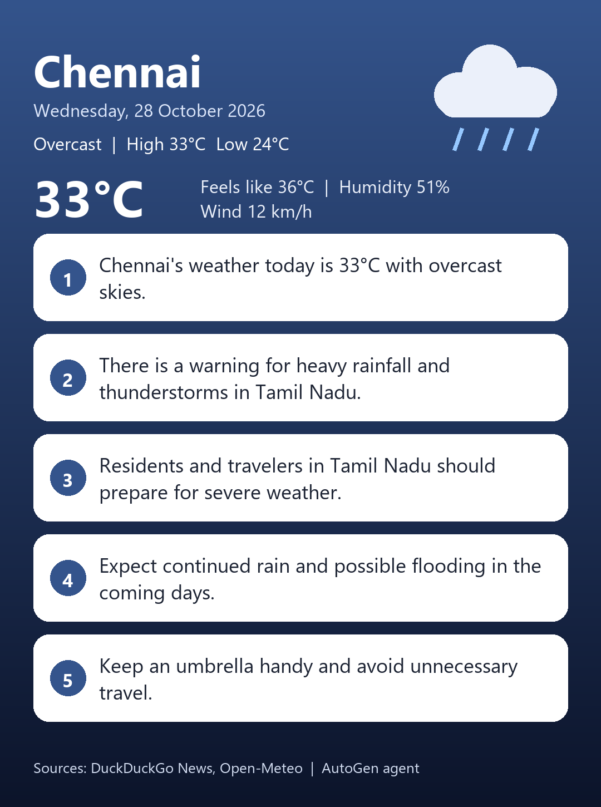
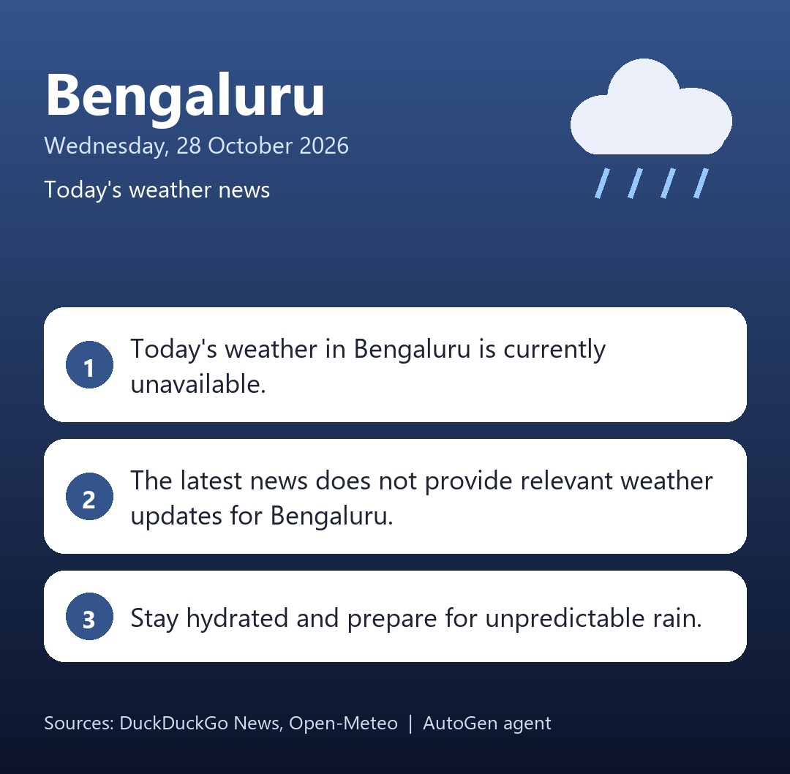
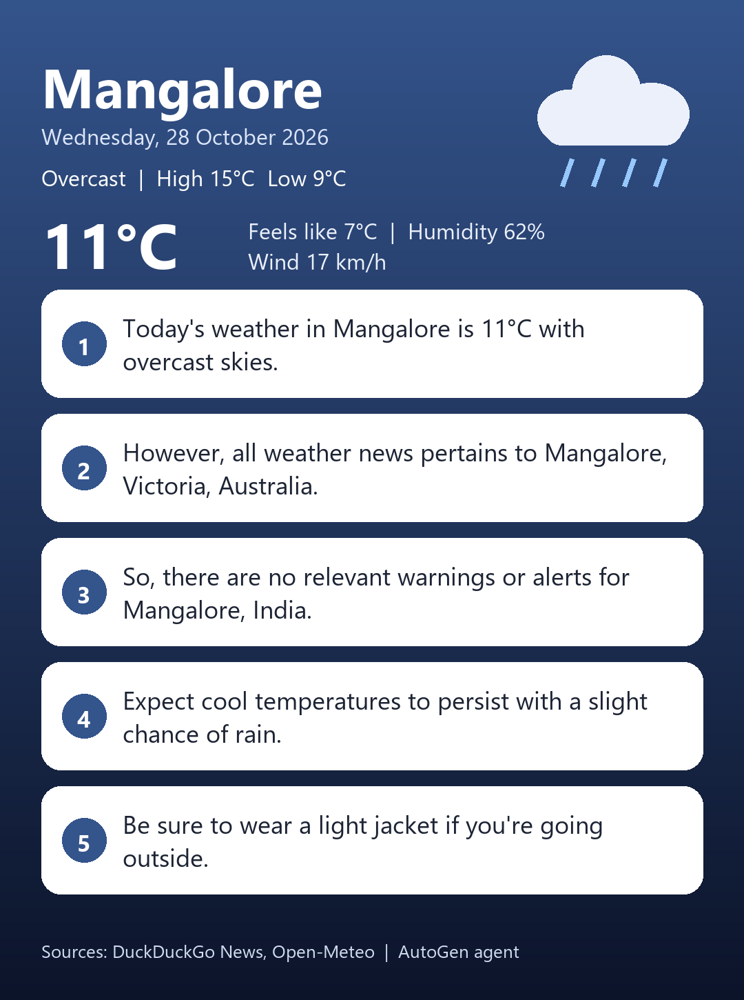
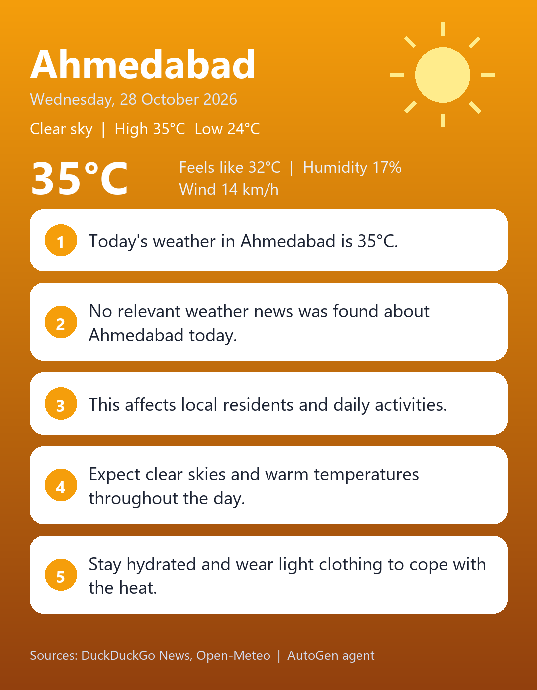

# AutoGen Weather News Agent

Week 5 · Day 2 assignment: an AutoGen team that takes a city name, looks up today's
weather and weather news, and replies in a fixed number of short lines (3 for the
assignment, 5 for the bonus version). It can also save the reply as a weather card picture.

## Sample output

| Chennai | Bengaluru | Mangalore | Ahmedabad |
| :-: | :-: | :-: | :-: |
|  |  |  |  |

## What it does

1. Asks `Which city?`.
2. **weather_news agent** calls two tools:
   - `get_temperature`: live temperature, feels-like, humidity, wind, high/low and rain
     chance from the free Open-Meteo API.
   - `search_weather_news`: latest weather headlines from DuckDuckGo News (`ddgs`, no key needed).
3. It writes the answer as exactly N short lines (one sentence each).
4. **reviewer agent** calls `check_line_count`, a plain Python function, and replies
   `APPROVE` only if the line count is right. If not, the writer fixes the format without
   calling the tools again.
5. Optionally saves a portrait weather card (`weather_<city>.png`) with Pillow.

## AutoGen concepts used

| Concept | Where |
| :-- | :-- |
| Tools | `search_weather_news`, `get_temperature`, `check_line_count` |
| Memory | `ListMemory` with the user's style preferences |
| Team of agents with roles | `RoundRobinGroupChat([weather_news, reviewer])` |
| Termination conditions | `TextMentionTermination("APPROVE") \| MaxMessageTermination(6)` |
| Streaming | `run_stream` with `Console`, or a clean custom view |
| Reading the result | `TaskResult` (`stop_reason`, `messages`) |
| Reset | `team.reset()` between cities (memory is kept) |

**Prompts are probability, code is deterministic.** The line count is checked by Python code,
not by asking the model to count, so the format rule is enforced reliably.

## Project structure

```
.
├── weather_news.py      # the agents, tools and picture card
├── requirements.txt     # dependencies
├── .env.example         # template for your API key
├── .gitignore           # keeps .env and venv/ out of Git
├── weather_*.png        # sample picture cards
└── README.md
```

## Setup

Python 3.10 to 3.12 and an OpenAI API key.

**Windows (PowerShell)**
```powershell
python -m venv venv
.\venv\Scripts\Activate.ps1
python -m pip install -r requirements.txt
```
If PowerShell blocks the script: `Set-ExecutionPolicy -Scope Process -ExecutionPolicy Bypass`.

**macOS / Linux**
```bash
python3 -m venv venv
source venv/bin/activate
python -m pip install -r requirements.txt
```

**API key:** copy `.env.example` to `.env` and set your key:
```
OPENAI_API_KEY=your_openai_api_key_here
```
`.env` is in `.gitignore`, so the key is never pushed to GitHub.

## Run

```bash
python weather_news.py
```
Enter a city such as `Chennai`. Press Enter on an empty city, or answer anything other
than `y` to the "Another city?" question, to stop.

## Settings (top of `weather_news.py`)

| Setting | Meaning |
| :-- | :-- |
| `NUM_LINES` | `3` for the assignment, `5` for the bonus version |
| `SHOW_FULL_LOG` | `True` shows the full AutoGen message log, `False` a clean view |
| `SAVE_IMAGE` | `True` saves the reply as a PNG card (needs Pillow) |

## Limits

- News depends on DuckDuckGo results, which can be old or about a different place with
  the same name. The agent is told to say so honestly in line 2.
- Temperature comes from Open-Meteo for the first matching place name.
- If a network call fails, the tool returns an error message and the agent reports it.
- Opening the picture automatically works on Windows only.

## Troubleshooting

| Problem | Cause | Fix |
| :-- | :-- | :-- |
| `OPENAI_API_KEY is not set` | `.env` missing or run from another folder | Create `.env` next to `weather_news.py` and run from there |
| `ModuleNotFoundError` | Packages not installed in the active venv | Activate the venv, then `python -m pip install -r requirements.txt` |
| `To save a picture, run: pip install pillow` | Pillow missing | It is in `requirements.txt`, reinstall |
| `Search failed: ...` | DuckDuckGo rate limit or network issue | Wait a minute and try again |
| Reply has the wrong number of lines | Model ignored the format | The reviewer asks for a rewrite automatically |
